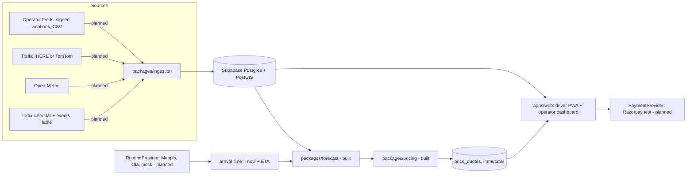

# Architecture

Status legend: **built** = code exists and is tested, **planned** = later slice.

## Decisions so far
- **Money is integer paise** end to end.
- **Pricing and forecast are pure TypeScript packages** with no I/O, so they run in the web app, cron jobs and tests alike.
- **`quote()` takes predicted occupancy as an input**; the caller gets it from `ForecastService` at `now + ETA`.
- **Forecast model** is an hour-of-week profile fitted on unflagged days with recency weighting, per-daypart flag effects (holiday, festival, event, rain) learned from history, a live-count residual that fades with horizon, and an interval calibrated on synthetic data (`SIGMA_SCALE`). The congestion coefficient is a hand-set prior, not learned.
- **Backtest gate** (`pnpm backtest`) fails CI when MAE, 80% interval coverage or Brier score regress past `packages/forecast/thresholds.json`.

## Not yet built
Database and RLS, auth, providers, ingestion, driver and operator UIs, reservations, payments, cron jobs. See the milestone list in the README.
